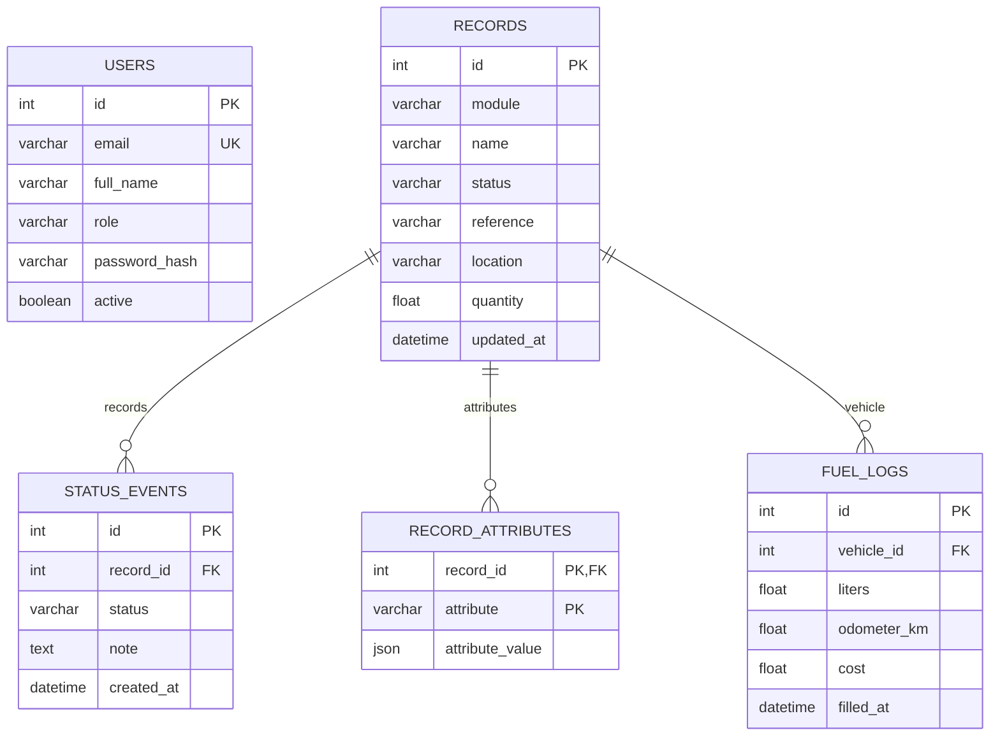

# Database design

MySQL 8 uses InnoDB, utf8mb4, indexed module/status/search and foreign keys. The shared `records` table holds common searchable operational fields. Module attributes live in `record_attributes`, one scalar per `(record_id, attribute)` key; the API assembles those rows as its `details` object. Users, status audit events and fuel logs are separate relational tables. A fuel log references its vehicle record. Status history and attributes are deleted with their parent record.

Apply with MySQL's init scripts via Compose, or run `mysql -u logicraft -p logicraft < database/schema.sql`. Alembic initial migration is at `backend/alembic/versions/0001_initial.py`.
